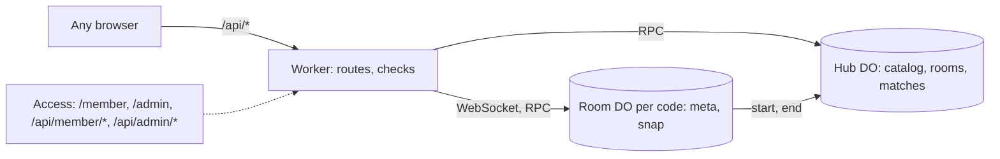

# 0002: Online rooms for members, guest join and shared scores

## Why

Today every match is on one device. Friends and family on different phones, tablets and laptops
want to play one match together, with scores every device sees. This is task 3 of the [games plan
v5][p], section 8: a `Room` Durable Object (DO) per match, one `Hub` DO, members who sign in with
Cloudflare Access to start rooms (docs/adr/0001-members-sign-in-with-access.md), and guests who
join by link or code with no login. It uses Shipify's `do` option (ADR 0068). The admin page is
change 0003, in the same release.

[p]: https://github.com/aayush-t-apps/shipify/blob/shipify-files/task-613/2026-10-30T14-57-03-920Z/games-plan.md

## Spec changes

### Added

- **US5 (P1): Start an online room (members)**. As a member, I want to start a room and share it,
  so that people on other devices play with me.
  - AC5.1 WHEN I am not signed in THE APP SHALL show **Sign in to play online** on the hub; WHEN
    I sign in at `/member` (Access, an email code) THE APP SHALL bring me back to the hub with
    **Play online** on each game that is on. A guest never sees a login.
  - AC5.2 WHEN I start a room (2–8 seats in the game's range, CPU seats and level) THE APP SHALL
    give a 6-letter code (31 letters, no look-alikes), the link `/r/<code>`, its QR code, and
    **Copy link** (or **Share**).
  - AC5.3 WHEN I am the room owner THE APP SHALL let me start, kick, lock, unlock, set CPU seats,
    rematch and close, and refuse these controls from any other device.
  - AC5.4 WHEN a `/api/member/*` call has no valid Access token (signature, audience, issuer or
    expiry) THE APP SHALL refuse it with 401 and change nothing.
- **US6 (P1): Join and play as a guest**. As anyone with a link or code, I want to join with only
  a nickname, so that I play online without an account.
  - AC6.1 WHEN I open `/r/<code>`, scan its QR code or type the code THE APP SHALL show the game
    and seats, ask once for a nickname (1–16 characters), load the game if needed, and give me
    the next free seat, or a spectator place when the room is full, locked or started.
  - AC6.2 WHEN the owner starts THE APP SHALL run the match on the host device (the owner's by
    default) and send each device only its own seat's view; spectators get the public view.
  - AC6.3 WHEN I move out of turn, with an old `seq` or for another seat THE APP SHALL refuse it
    and say why (as AC1.5).
  - AC6.4 WHEN my device drops (network, sleep, a deploy) THE APP SHALL reconnect by itself (1, 2,
    4 … 15 s) and give back my seat and the latest view.
  - AC6.5 WHEN the host drops, or a player taps **Make me host**, THE APP SHALL make that next
    device the host, going on from the room's last snapshot.
  - AC6.6 WHEN a player is offline for 60 s on their turn THE APP SHALL let the host's CPU play
    for them until they are back.
  - AC6.7 WHEN the code is unknown or the room has ended THE APP SHALL say "This room has ended"
    and offer the hub; WHEN the device's game or protocol version differs it SHALL ask to reload.
- **US7 (P1): Shared scores**. As a player, I want online results kept for every device, so that
  we know who is winning.
  - AC7.1 WHEN an online match ends THE APP SHALL show the places on every device and record the
    match once in the Hub (game, nicknames, places, length, seats, CPU seats).
  - AC7.2 WHEN I open **Scores** THE APP SHALL show, per game, the top players by wins and the last
    20 online matches.
- **US9 (P3): A big screen as the table**. As a family at a TV, I want a big screen to show the
  board while phones hold the hands, so that everyone watches one table.
  - AC9.1 WHEN I join a room as **Table** THE APP SHALL take no seat and show the public view large
    to the end of the match.

### Changed

- `view(state, null)` is the public view (Crazy Eights and Go Fish change). The engine gains
  `snapshot()`, `from`, a public view per round and `autoplay(seat)`; online has no Undo. The
  service worker never caches `/api/*`, `/member`, `/admin` (keeps the last `/api/catalog`).
  Out of scope loses online play. No PR previews from now on (ADR 0068): `make dev` instead.

### Removed

- None.

## Alternatives considered

- Open room start with counters (plan v3): strangers could use up the free plan. Our own
  accounts: an email service and a secret (ADR 0001). A server referee: the server would know
  every game. PartyServer, boardgame.io, Firebase: a dependency for a 150-line relay. D1 for
  scores: a second resource; the Hub's SQLite is enough.

## UI

- **Hub:** **Sign in to play online**, **Join a room**, **Scores**, **Play online** per game.
  **Lobby** (`/r/<code>`): code, QR, **Copy link**, seats, **Join as Table**; owner: **Start**.
  **Match:** a bar (code, host, **Make me host**). **Result:** places, **Rematch**, **Scores**.

## Design

- **Routes** (plan 8.2): `GET /api/catalog` (60 s edge cache), `GET /api/member/me`, `POST
  /api/member/rooms` → `{code, ownerToken}`, `GET /api/rooms/:code`, `GET /api/rooms/:code/ws`,
  `GET /api/scores?game=`. Checks: a known game that is on, seats 2–8, nickname 1–16, bodies up
  to 2 KB, and an `Origin` equal to the app's own on writes and the WebSocket.
- **Access check** (`access.ts`): RS256 `Cf-Access-Jwt-Assertion`, `aud`, `iss`, `exp` (ADR 0001).
  No `ACCESS_TEAM`: 503, except on `localhost` (`dev@localhost`, for `make dev` and tests).
- **Room DO** (`objects/room.ts`, logic in `room-logic.ts`): `meta` (seats with hashed tokens)
  and `snap` (one write per move); hibernating sockets; messages as plan 8.4 plus `take-host`,
  only the envelope checked. Caps: 8 seats, 8 spectators, 4 KB (32 KB `state`), 20 a second. One
  alarm (6 h, or 10 min empty) ends it. The host runs the 60 s idle timer: no extra alarm.
- **Hub DO** (`objects/hub.ts`, SQL in `hub-sql.ts`): tables `catalog`, `rooms`, `matches`
  (plan 8.6). Called at a room's start and end, a list load or an admin act; never per move.
- **Client:** `net/room.js` (the `room` transport, as `local`, with reconnect; seat token in
  `sessionStorage`), `online.js` (loaded only for online play), `qr.js` (QR to SVG), `/member`.
- **Config:** option `do`, runtime secret `ADMIN_EMAIL`, bindings `ROOM` and `HUB` in `exports`
  (SQLite), `vars` `ACCESS_TEAM` and `ACCESS_AUD`.
- **Failures:** a deploy closes sockets; devices reconnect, the host goes on from `snap`. A free
  limit hit: "Online play is busy, try later". Limits: plan section 10; Access, 50 members.

## Rollout and rollback

- Ships in 0.2.0. Online buttons stay hidden until the owner's Access setup (ADR 0001, Setup).
  Classes only add; Cloudflare refuses a rollback across them: roll forward.

## Docs and clean-up

- `docs/spec.md`, `README.md` (online play, setup), `AGENTS.md` (the two DOs, add-only; never log
  the Access header), `CHANGELOG.md`, version 0.2.0 (also `site/sw.js`).

## Tasks

- [x] T1 [US5] Config (`ship upgrade`), Access and input checks — files: `shipify.json`,
  `wrangler.jsonc`, `src/worker/access.ts`, `src/worker/checks.ts` — verifies: AC5.4
- [x] T2 [US6] Room DO — files: `src/worker/objects/room.ts`, `src/worker/room-logic.ts` —
  verifies: AC5.3, AC6.1, AC6.3, AC6.5, AC6.7
- [x] T3 [US7] Hub DO and routes — files: `src/worker/objects/hub.ts`, `src/worker/hub-sql.ts`,
  `src/worker/app.ts` — verifies: AC7.1, AC7.2
- [x] T4 [US6] Engine and `view(state, null)` — files: `site/lib/engine.js`,
  `site/games/*/rules.js` — verifies: AC6.2, AC6.5, AC6.6
- [x] T5 [US5, US6, US7, US9] Room transport, online screens, QR, reconnect, Table, Scores,
  service worker, `/member` — files: `site/lib/`, `site/sw.js`, `site/member/` — verifies: AC5.1,
  AC5.2, AC6.4, AC7.2, AC9.1
- [x] T6 [all] Tests (`localWorker()`; e2e: a desktop and a phone play Four in a Row online, the
  places and Scores show), docs, 0.2.0 — files: `tests/`, `docs/` — verifies: AC6.2, AC7.1

## Verification

- `make verify` passes; `docs/spec.md` matches. After setup, two phones play from one link.
