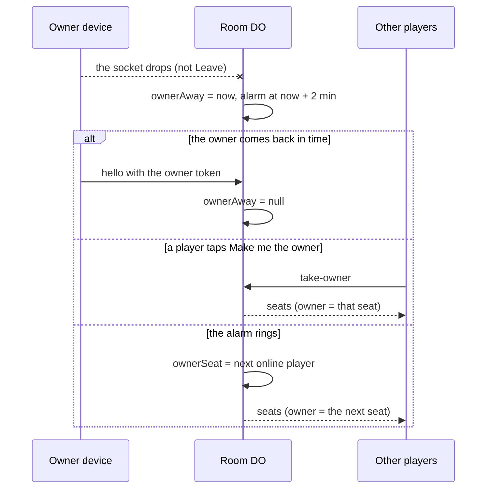

# 0004: Online play on: the owner role passes on, player counts, restore, a cleaner UI

## Why

The owner's Access setup is done, so online play can go on. Three gaps were left from 0.2.0: a
room's controls stayed with the member who started it even after they left, the admin couldn't
see how many people sit in a room, and the only backup was a manual **Export**. The hub, lobby and
admin page also needed a cleaner layout on a phone and a desktop.

## Spec changes

### Added

- AC5.5 WHEN the owner taps **Leave the room** THE APP SHALL open their seat and give the owner's
  controls to the next online player; WHEN the owner's device only drops, THE APP SHALL keep the
  role for 2 minutes, then pass it to the next online player, unless the device comes back first;
  meanwhile any player MAY tap **Make me the owner**. A member who comes back to their room after
  that gets their seat, not the role.
- AC5.6 WHEN any player taps **Leave the room** THE APP SHALL open the seat for someone else and
  forget that tab's seat token.
- AC8.6 WHEN I open **Rooms** or the **Overview** THE APP SHALL show how many people sit in each
  room (and in all), which each room reports to the Hub only when the count changes.
- AC8.7 WHEN I click a column head in an admin table THE APP SHALL sort the table by it; a second
  click sorts it the other way.
- AC8.8 WHEN I pick a time in the last 30 days under **Scores → Restore** and confirm THE APP SHALL
  put all Hub data back as it was then (Cloudflare's point-in-time recovery), and offer **Undo the
  restore**, which puts it back as it was just before.

### Changed

- AC5.1: a guest's hub leads with **Join a room**; a signed-out member gets **Members: sign in**
  (it was **Sign in to play online**).
- AC5.3: the owner's controls belong to the seat that holds the owner role (seat 0 at first), not
  always to seat 0. The owner may kick seat 0 once the role has passed.
- The owner's Access values (`ACCESS_TEAM`, `ACCESS_AUD`) are in `wrangler.jsonc`, so online play
  is on. A request to `localhost` is always the developer, with or without them.

### Removed

- None.

## Alternatives considered

- **A scheduled backup** (cron to R2, or a GitHub job with an Access service token): a new service
  or a new secret. Point-in-time recovery needs nothing new, and **Export** stays for a copy kept
  elsewhere.
- **Pass the owner role at once on a drop:** a phone that sleeps for a moment would lose it. Two
  minutes rides out a short drop.
- **Count players by polling each room** from the admin page: one call per room per open. The room
  tells the Hub only when the count changes.

## UI

- **Hub:** the online panel is a felt strip led by **Join a room**, with **Online scores**,
  **Members: sign in** (signed out) or **Play online** on each game (signed in), and **Admin** for
  the owner. Offline, scores and install sit side by side on wide screens.
- **Forms:** each label above a full-width field, with a short hint. **Join as Table** is in its
  own panel that says what it is for.
- **Lobby:** two panels, **Invite** (the code, QR code, link, **Share** or **Copy link**) and
  **Seats** (one row per seat: name, the tags owner, host and you, and here, away, free or CPU).
  The owner sees Invite first, everyone else Seats first. **Close the room** and **Kick** are red;
  **Leave the room** asks first. While the owner is away: "Ana is away. The owner's controls pass to
  the next player at 21:42." with **Make me the owner**.
- **Admin:** "Signed in as …" and **Members** in the header; tabs on one line (arrow keys move
  between them); fact cards (live rooms, people in them, matches today, matches in 30 days);
  tables that scroll on a phone and sort by column; Games as a list (On, Featured, ↑ ↓); Rooms with
  players and a link to each room; Scores opens on the most played game, with **Export** and
  **Restore** (a date and time, **Restore…**, then **Undo the restore**).

## Design

- **Room meta** gains `ownerSeat` (the seat with the controls), `ownerAway` (when the owner's
  device dropped while others stayed) and `reported` (the people count the Hub last got). A room
  stored by 0.2.x gets them when it loads (`upgrade`). Seat 0 is kept for the member's owner token
  until that device leaves or is kicked; then the token stops working (`meta.owner = ""`).
- **Messages:** device → room `leave` (the seat opens, the role passes on, the room closes the
  socket) and `take-owner` (refused while the owner is online). `seats.room` gains `owner` and
  `ownerAway`.
- **The alarm:** `alarmAt` is the room's end, 10 minutes after it empties, or `ownerAway + 2 min`,
  whichever is first. At the alarm, `ownerDue` passes the role. When the last device leaves,
  `ownerAway` clears, so an empty room still waits its full 10 minutes.
- **Hub:** `rooms.players` (added once to a Hub made by 0.2.x: `ALTER TABLE … ADD COLUMN` when
  `PRAGMA table_info` lacks it; 0.2.x code ignores it), set by RPC `seated(code, n)`.
- **Restore:** `POST /api/admin/restore` `{at}` (a time within 30 days, not in the future) or
  `{bookmark}`. The Hub calls `getBookmarkForTime(at)`, then `onNextSessionRestoreBookmark(…)`,
  which returns the bookmark of now (the undo), then the Worker calls `restart()`
  (`ctx.abort()`), so the Hub starts again on the restored data. Local workerd has no
  point-in-time recovery: there the route answers 400 "Cloudflare can't restore that point".

## Rollout and rollback

- Ships in 0.3.0. Live rooms keep going: their meta upgrades when it loads, and the Hub adds its
  column once. The only stored change is the new column, which old code ignores. A rollback is
  refused across the Durable Object classes from 0.2.0 anyway: fix forward.
- Needs the GitHub secret `ADMIN_EMAIL` (the owner's Google email) for `/admin`; nothing else.

## Docs and clean-up

- `docs/spec.md` (AC5.1, AC5.3, AC5.5, AC5.6, AC8.6–AC8.8, the messages, the room and Hub data,
  the routes), `README.md` (online play is on; backup is Export plus Restore), `DESIGN.md` (the
  lobby and admin screens), `CHANGELOG.md`. Nothing removed.

## Tasks

- [x] T1 [US5] The owner's Access values; localhost is the developer — files: `wrangler.jsonc`,
  `src/worker/access.ts` — verifies: AC5.1
- [x] T2 [US5] The owner role: leave, take-owner, the 2-minute wait at the alarm — files:
  `src/worker/room-logic.ts`, `src/worker/objects/room.ts` — verifies: AC5.3, AC5.5, AC5.6
- [x] T3 [US8] People per room in the Hub — files: `src/worker/hub-sql.ts`,
  `src/worker/objects/hub.ts` — verifies: AC8.6
- [x] T4 [US8] Restore and undo — files: `src/worker/app.ts`, `src/worker/checks.ts`,
  `src/worker/objects/hub.ts`, `site/admin/admin.js` — verifies: AC8.8
- [x] T5 [US5, US8] The UI: hub, forms, lobby, admin, sortable tables — files: `site/lib/`,
  `site/admin/` — verifies: AC5.1, AC5.5, AC8.6, AC8.7

## Verification

- `make verify` passes. `docs/spec.md` is updated to match this change. The restore itself runs
  only on Cloudflare: after the deploy, the owner can check it once (Restore to a minute ago, then
  Undo).
