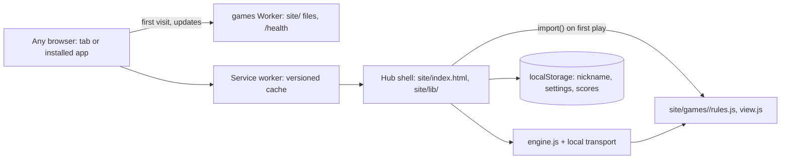

<!-- Living spec: what this app is NOW. Every change doc's implementation updates it.
     History: docs/changes/. Releases: CHANGELOG.md. -->

# Games: classic games on any device, offline

## Goal

A game room for family, kids and friends at `games.app.a69x.in`. Anyone opens it in a browser on a
phone, tablet, laptop or TV, or installs it as an app, and plays six classic games solo against the
CPU or pass-and-play on one device, offline. Kid mode teaches. Scores stay in that browser. This is
task 1 of the [games plan v5][p] (task #613): no server state, no sign-in. Online rooms come later
in their own task (#616), through the transport seam below, with no change to the games.

[p]: https://github.com/aayush-t-apps/shipify/blob/shipify-files/task-613/2026-10-30T14-57-03-920Z/games-plan.md

## Out of scope

Online rooms, members, the admin page, the Hub and its scoreboard (task #616). Accounts, chat,
real-time games, gamepads, a big-screen table view, sync between devices (Export and Import move
data instead), commercial game names or art, third-party art, a WebAssembly engine.

## Stories

- **US1 (P1): Play a game against the CPU**. As anyone, I want to pick a game and play it against
  CPU players, so that I can play alone on any device.
  - AC1.1 WHEN I open `/` THE APP SHALL list the six games (Crazy Eights, Go Fish, Memory, Ludo,
    Four in a Row, Quiz Race) from `site/games/index.json`, each with its type, players and ages.
  - AC1.2 WHEN I start a game with 1 human and 1–5 CPU seats (within the game's player range) and a
    level (easy, normal, hard) THE APP SHALL play the match to the end, with CPU moves after a short
    pause, and show the places.
  - AC1.3 WHEN any game is played CPU against CPU from 200 seeds THE APP SHALL make only moves from
    `legalMoves`, end every match with a winner or a draw, and give the same match for the same seed.
  - AC1.4 WHEN a CPU seat chooses a move on hard THE APP SHALL answer within 100 ms on the test box.
  - AC1.5 WHEN a move isn't legal THE APP SHALL refuse it, keep the state, and say why in one line.
- **US2 (P1): Pass-and-play on one device**. As a family at one table, I want to take turns on one
  phone or tablet, so that we play together with no network.
  - AC2.1 WHEN a match has 2 or more human seats THE APP SHALL show whose turn it is, by name, and
    take the move only from that seat's controls.
  - AC2.2 WHEN the next human seat holds hidden cards (Crazy Eights, Go Fish) THE APP SHALL cover
    the screen with "Pass to <name>" and show that seat's hand only after a tap.
  - AC2.3 WHEN I play with the keyboard only THE APP SHALL let me move a focus ring over cards or
    cells with the arrow keys, play with Enter, and hear each turn and move through an ARIA live
    region.
- **US3 (P1): Offline on any device, installable**. As a player on the move, I want the app to open
  and play with no signal, so that a trip or a flight is no problem.
  - AC3.1 WHEN the hub was opened once online and the network is off THE APP SHALL open the hub and
    every game opened before, and play them.
  - AC3.2 WHEN I tap "Download all for offline" THE APP SHALL cache every game and say "All games
    ready offline" only after each one is cached.
  - AC3.3 WHEN a new version is deployed and I open the app online THE APP SHALL show "Update
    ready", and one tap reloads it with the new files, never a mix of old and new.
  - AC3.4 WHEN the browser offers an install (`beforeinstallprompt`) THE APP SHALL show an Install
    button; on iPhone and iPad it SHALL show a short "Share → Add to Home Screen" card instead.
  - AC3.5 WHEN the screen is a narrow phone, a landscape tablet or a desktop THE APP SHALL use the
    compact, wide or desk layout, and a rotation or resize keeps the match going.
- **US4 (P2): Kid mode and my scores**. As a parent, I want a gentle mode for kids and a record of
  wins, so that kids learn and everyone sees their progress.
  - AC4.1 WHEN kid mode is on THE APP SHALL highlight legal moves, show a Hint button (the CPU's move
    for that seat), allow Undo back to the human's last turn, use large targets, and offer only the
    easy level.
  - AC4.2 WHEN a match ends THE APP SHALL add it to that browser's scores (played, won, per game and
    level, and the last 20 results) and show them on the hub, with no network request.
  - AC4.3 WHEN I tap Export THE APP SHALL save one JSON file with my nickname, settings and scores;
    WHEN I import that file on another device THE APP SHALL load it, and refuse a file that isn't
    one, with the reason, changing nothing.
  - AC4.4 WHEN the app starts THE APP SHALL ask for persistent storage (`navigator.storage.persist`).

## UI

Design brief (`DESIGN.md`), in short:
- **Tone:** warm, bold, tactile. A wooden games box and a felt card table, not a casino.
- **Palette:** felt green `#1f5f46`, wood `#8a5a2b`, paper `#f7f4ec`, ink `#1b1b1b`, red `#c0392b`
  and blue `#2457a6` for suits and pieces (Ludo adds yellow `#e0a800` and green `#2e8b57`). Dark
  mode follows the device; a high-contrast theme. Text at least 4.5:1.
- **Type:** the system UI font; large numbers and card ranks in its bold weight.
- **The one memorable element:** big, crisp cards and pieces that move with a short slide.
- **Screens (one primary action each):** Hub (the game list; **Play**), Setup (seats, CPU level,
  kid mode; **Start**), Match (the board; play a move), Result (places; **Play again**), Settings
  (nickname, kid mode, theme, sound, Export and Import, Install).
- **States:** first visit (nickname, optional; "Player" by default), loading a game ("Getting
  Ludo…"), offline (a small "Offline" mark; games not yet cached say "Needs signal once"), "Update
  ready", an old browser ("Please update your browser to play").
- **Layouts:** compact (narrow portrait: board on top, own hand as a fan at the bottom, menus as
  bottom sheets), wide (landscape and tablets: players around the board), desk (adds a side panel
  with the moves log and scores). CSS grid, `clamp()`, container queries and safe-area insets.
- **Mobile:** 360 px, 44 px targets (larger in kid mode). **Offline:** yes. **Installable:** yes.

## Design

### Architecture

Static files only: the stack's Worker serves `/health`, and every other path is a file from
`site/`, or `index.html` (the stack's single-page fallback).

**The game interface** (every `site/games/<id>/rules.js`), pure and deterministic, with no DOM or
network: metadata `{id, name, version, players: {min, max}, hidden, realtime: false}`, and:

- `init(seats, seed)`: the state for a number of seats. States are plain JSON. Each has `turn` (the
  seat to move), `moves`, `rng` (the seeded generator, `site/lib/rng.js`) and `note` (the last
  move in words, with `@n` for seat n's name: "@0 played Q♥").
- `view(state, seat)`: what that seat may see. In a `hidden` game, only its own hand.
- `legalMoves(state, seat)`: the moves that seat may make now; empty for every other seat. Moves
  are small flat objects (`{t: "drop", col: 3}`).
- `apply(state, seat, move)`: the next state; the given state is never changed. It throws an
  `Error` whose message is the one-line reason (AC1.5).
- `winner(state)`: `null`, or `{places}`: groups of seats, best first; tied seats share a group
  (`[[1], [0, 2]]`). A draw is one group of every seat. Every game also ends after a fixed number
  of moves, so no match runs for ever.
- `ai(state, seat, level)`: the CPU's move for `easy`, `normal`, `hard`, and `best` (the hint). It
  sees only what that seat may see, and gives the same move for the same position.

Each game's screen is `site/games/<id>/view.js`: `render(box, ctx)` draws the view into the box
(HTML buttons with SVG inside, each with `data-x`, `data-y` and `data-key` for the keyboard),
`status(view, seat)` gives each player's chip text, and `hintText(move, view, names)` words a hint.
`ctx` has the view, the legal moves, the seat shown, the names, kid mode, the hint, the layout,
`play(move)` and `say(text)`.

**Engine messages** (each with `v: 1`). To the engine: `{t: "move", seat, seq, move}`,
`{t: "undo", seat}`, `{t: "hint", seat}`. From it: `{t: "view", seat, seq, turn, view, legal, note,
last, places}` for every seat after every change, `{t: "refused", seat, reason}`,
`{t: "hinted", seat, move}`, `{t: "end", places}` and `{t: "crash", reason}`. A move from the wrong
seat, a CPU seat, or with an old `seq` is refused. Undo takes back the human's last move and the
CPU moves after it.

**Shared modules (`site/lib/`):**
- `engine.js`: the host-authoritative runner. It holds the state, takes moves from seats, checks
  them, applies them, sends each seat its view, runs CPU seats, keeps `turn` and `seq`, and keeps
  the history for Undo. It talks to seats only through a transport.
- `net/local.js`: the `local` transport, `send(msg)`, `onMessage(cb)`, `peers()`, in one page. Task
  #616 adds `net/room.js` with the same interface; the engine and the games don't change.
- `rng.js` (seeded), `deck.js` (shuffle, deal, hands, draw and discard piles), `board.js` (grids
  and tracks), `cards.js` (SVG cards and pieces, drawn by code).
- `ui.js` (hint, undo, kid mode, pass screen, live region, sound as short Web Audio tones,
  vibration where the browser has it), `input.js` (pointer and keyboard to actions), `layout.js`
  and `app.css`, `store.js` (`localStorage`, Export, Import), `install.js` (install button, iOS
  card, update prompt).

The import rule, checked by a unit test: `rules.js` imports only `site/lib/{rng,deck,board}.js`;
only `store.js` touches `localStorage`.

**The six games** (all `realtime: false`):

| Game | Type | Players | Notes |
|---|---|---|---|
| Crazy Eights | cards | 2–6 | 52 cards; match suit or rank, an 8 names a suit; first out wins |
| Go Fish | cards | 2–6 | Ask a seat for a rank; books of four; most books wins |
| Memory | kids | 1–4 | Pairs face down; a match scores and plays again. CPU recall by level |
| Ludo | board | 2–4 | A 6 leaves base, captures, safe squares, a 6 plays again (a third 6 ends the turn), an exact roll to finish; the first with four tokens home wins |
| Four in a Row | board | 2 | 7×6 grid. The owner's "Connect 4", named generically (no trade names) |
| Quiz Race | kids | 1–4 | Answer a question (maths made from the seed, or a short JSON pack of kids' facts); right moves you a step on a 10-step track; first home wins. CPU right by level (60, 80, 95 %) |

**Offline.** `site/sw.js` holds the app's version (a unit test keeps it equal to `shipify.json`'s),
so each release installs a new service worker. It precaches the hub shell into a cache named for
that version, caches a game folder on its first open, re-fetches the games the old cache had, and
deletes the old cache when it takes over (AC3.3). Every request is cache first, so a match never
mixes versions and an opened app makes no requests. `sw.js` itself is `no-cache` in `_headers`.
The first release takes over at once; a later one waits until the player taps **Reload with the
update**. **Download all for offline** asks the service worker to save every game's two files, then
checks each one in the cache before it says "All games ready offline" (AC3.2).

### Data

Only in the browser, in `localStorage` key `games.v1`: `{player: {id, nick, named}, settings: {kid,
theme, sound}, scores: {<game>: {<level>: {played, won}}}, recent: [last 20 {game, level, won,
place, at}]}`, about 5 KB. `named` is false until the first-visit name is saved or skipped. The
level is `easy`, `normal`, `hard`, or `friends` for a match with no CPU. Scores are seat 1's (the
device's player); a win is first place alone. Export and Import use the same shape with a
`format: "games.v1"` field; an import keeps only the known fields. Nothing on the server; a
rollback is code only. A match in progress isn't kept: closing the tab ends it.

`site/games/index.json` lists each game: `id, name, type, players, cpu, ages, teaching, version,
kb, about`. A unit test checks that every folder has an entry, holds only `rules.js` and
`view.js`, and that `kb` matches the folder's size (rounded up).

**The CPU levels.** Four in a Row searches 1, 3 or 6 moves ahead (easy, normal, hard). Memory's CPU
remembers each card it saw with a 35, 70 or 95 % chance. Quiz Race's CPU is right 60, 80 or 95
times in 100. The card games and Ludo use simple rules that get smarter by level.

### Failure modes

- A game's files fail to load (offline, never cached): "Needs signal once", and the hub stays.
- A rules error mid-match: the match stops with "Something went wrong. Start again?", logged to the
  console; scores aren't changed.
- `localStorage` is full or blocked (private mode): play works, and Settings says scores can't be
  kept. iPhone Safari may clear a non-installed site's data after 7 days unused: the iOS card says
  to install, or to Export.

### Limits

- The first load is the hub shell and `site/lib/`, inside the 80 KB JS budget; each game loads with
  `import()`, a few tens of KB. Static file requests are free; the Worker sees only `/health`.
- Browsers from about the last 3 years (ES modules, service worker, container queries, Pointer
  Events). Older ones get the "please update" page.

## Docs and clean-up

- `docs/spec.md`: the game interface, the engine and transport seam, the import rule, offline and
  the data shape. `AGENTS.md`: how to add a game (`games: add <name>`: a folder, an `index.json`
  line, the shared tests pass) and to keep `sw.js`'s version in step.
- `README.md`: what it is, how to install on each platform, Export and Import.
- The preset's starter page and its e2e test are replaced.
