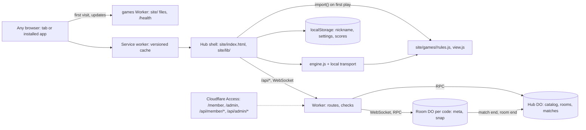

<!-- Living spec: what this app is NOW. Every change doc's implementation updates it.
     History: docs/changes/. Releases: CHANGELOG.md. -->

# Games: classic games on any device, offline and online

## Goal

A game room for family, kids and friends at `games.app.a69x.in`. Anyone opens it in a browser on a
phone, tablet, laptop or TV, or installs it as an app, and plays six classic games solo against the
CPU or pass-and-play on one device, offline. Kid mode teaches. Scores stay in that browser. Members
(signed in with Cloudflare Access) start online rooms; anyone joins one by link, code or QR code
with a nickname, from any device, and the online scores are shared. The owner runs it from
`/admin`. This is the [games plan v5][p] (task #613), tasks 1 and 3.

[p]: https://github.com/aayush-t-apps/shipify/blob/shipify-files/task-613/2026-10-30T14-57-03-920Z/games-plan.md

## Out of scope

Accounts of our own (members are an Access list), chat, real-time games and the P2P transport,
gamepads, moving a device's own scores to another device (they stay where they were played),
commercial game
names or art, third-party art, a WebAssembly engine, a neutral server referee (the host device runs
the rules), counting solo play on the server.

## Stories

- **US1 (P1): Play a game against the CPU**. As anyone, I want to pick a game and play it against
  CPU players, so that I can play alone on any device.
  - AC1.1 WHEN I open `/` THE APP SHALL list the six games (Crazy Eights, Go Fish, Memory, Ludo,
    Four in a Row, Quiz Race) from `site/games/index.json`, each with its type, players and ages.
  - AC1.2 WHEN I start a game with 1 human and 1–5 CPU seats (within the game's player range) and a
    level (easy, normal, hard) THE APP SHALL play the match to the end, with CPU moves after a short
    pause, and show the places.
  - AC1.3 WHEN any game is played CPU against CPU from 200 seeds THE APP SHALL make only moves from
    `legalMoves`, end every match with a winner or a draw, and give the same match for the same seed.
  - AC1.4 WHEN a CPU seat chooses a move on hard THE APP SHALL answer within 100 ms on the test box.
  - AC1.5 WHEN a move isn't legal THE APP SHALL refuse it, keep the state, and say why in one line.
- **US2 (P1): Pass-and-play on one device**. As a family at one table, I want to take turns on one
  phone or tablet, so that we play together with no network.
  - AC2.1 WHEN a match has 2 or more human seats THE APP SHALL show whose turn it is, by name, and
    take the move only from that seat's controls.
  - AC2.2 WHEN the next human seat holds hidden cards (Crazy Eights, Go Fish) THE APP SHALL cover
    the screen with "Pass to <name>" and show that seat's hand only after a tap.
  - AC2.3 WHEN I play with the keyboard only THE APP SHALL let me move a focus ring over cards or
    cells with the arrow keys, play with Enter, and hear each turn and move through an ARIA live
    region.
- **US3 (P1): Offline on any device, installable**. As a player on the move, I want the app to open
  and play with no signal, so that a trip or a flight is no problem.
  - AC3.1 WHEN the hub was opened once online and the network is off THE APP SHALL open the hub and
    every game opened before, and play them.
  - AC3.2 WHEN I tap "Download all for offline" THE APP SHALL cache every game and say "All games
    ready offline" only after each one is cached.
  - AC3.3 WHEN a new version is deployed and I open the app online THE APP SHALL show "Update
    ready", and one tap reloads it with the new files, never a mix of old and new.
  - AC3.4 WHEN the browser offers an install (`beforeinstallprompt`) THE APP SHALL show an Install
    button; on iPhone and iPad it SHALL show a short "Share → Add to Home Screen" card instead.
  - AC3.5 WHEN the screen is a narrow phone, a landscape tablet or a desktop THE APP SHALL use the
    compact, wide or desk layout, and a rotation or resize keeps the match going.
- **US4 (P2): Kid mode and my scores**. As a parent, I want a gentle mode for kids and a record of
  wins, so that kids learn and everyone sees their progress.
  - AC4.1 WHEN kid mode is on THE APP SHALL highlight legal moves, show a Hint button (the CPU's move
    for that seat), allow Undo back to the human's last turn, use large targets, and offer only the
    easy level.
  - AC4.2 WHEN a match ends THE APP SHALL add it to that browser's scores (played, won, per game and
    level, and the last 20 results) and show them on the hub, with no network request.
  - AC4.4 WHEN the app starts THE APP SHALL ask for persistent storage (`navigator.storage.persist`).
- **US5 (P1): Start an online room (members)**. As a member, I want to start a room and share it,
  so that people on other devices play with me.
  - AC5.1 WHEN I am not signed in THE APP SHALL lead the hub's online panel with **Join a room**
    and show **Members: sign in**; WHEN I sign in at `/member` (Access) THE APP SHALL bring me back
    to the hub with **Play online** on each game that is on. A guest never sees a login.
  - AC5.2 WHEN I start a room (2–8 seats in the game's range, CPU seats and level) THE APP SHALL
    give a 6-letter code (31 letters, no look-alikes), the link `/r/<code>`, its QR code, and
    **Copy link** (or **Share**).
  - AC5.3 WHEN my seat holds the owner role (seat 0 at first) THE APP SHALL let me start, kick,
    lock, unlock, set CPU seats, rematch and close, and refuse these controls from any other seat.
  - AC5.4 WHEN a `/api/member/*` call has no valid Access token (signature, audience, issuer or
    expiry) THE APP SHALL refuse it with 401 and change nothing.
  - AC5.5 WHEN the owner taps **Leave the room** THE APP SHALL open their seat and give the owner's
    controls to the next online player; WHEN the owner's device only drops, THE APP SHALL keep the
    role for 2 minutes, then pass it to the next online player, unless the device comes back first;
    meanwhile any player MAY tap **Make me the owner**. A member who comes back to their room after
    that gets their seat, not the role.
  - AC5.6 WHEN any player taps **Leave the room** THE APP SHALL open the seat for someone else and
    forget that tab's seat token.
- **US6 (P1): Join and play as a guest**. As anyone with a link or code, I want to join with only
  a nickname, so that I play online without an account.
  - AC6.1 WHEN I open `/r/<code>`, scan its QR code or type the code THE APP SHALL show the game
    and seats, ask once for a nickname (1–16 characters), load the game if needed, and give me
    the next free seat, or a spectator place when the room is full, locked or started.
  - AC6.2 WHEN the owner starts THE APP SHALL run the match on the host device (the owner's by
    default) and send each device only its own seat's view; spectators get the public view.
  - AC6.3 WHEN I move out of turn, with an old `seq` or for another seat THE APP SHALL refuse it
    and say why (as AC1.5).
  - AC6.4 WHEN my device drops (network, sleep, a deploy) THE APP SHALL reconnect by itself (1, 2,
    4 … 15 s) and give back my seat and the latest view.
  - AC6.5 WHEN the host drops, or a player taps **Make me host**, THE APP SHALL make that next
    device the host, going on from the room's last snapshot.
  - AC6.6 WHEN a player is offline for 60 s on their turn THE APP SHALL let the host's CPU play
    for them until they are back.
  - AC6.7 WHEN the code is unknown or the room has ended THE APP SHALL say "This room has ended"
    and offer the hub; WHEN the device's game or protocol version differs it SHALL ask to reload.
- **US7 (P1): Shared scores**. As a player, I want online results kept for every device, so that
  we know who is winning.
  - AC7.1 WHEN an online match ends THE APP SHALL show the places on every device and record the
    match once in the Hub (game, nicknames, places, length, seats, CPU seats).
  - AC7.2 WHEN I open **Scores** THE APP SHALL show, per game, the top players by wins and the last
    20 online matches.
- **US8 (P2): Run the hub (admin)**. As the owner, I want one page to see use and manage the
  games, so that I keep what is played and turn off the rest.
  - AC8.1 WHEN I open `/admin` THE APP SHALL show four tabs, from one `GET /api/admin/stats` per
    open or **Refresh**: **Overview** (live rooms and by which member, matches today; per game:
    type, players, CPU, size, on or off, matches in 7 and 30 days, average length and players,
    last played; matches per type in 30 days; hints "not played in 60 days" and "most played";
    the app's size), **Games**, **Rooms** and **Scores**.
  - AC8.2 WHEN I turn a game off THE APP SHALL take it off the hub within about a minute, refuse
    new rooms for it, keep its scores, and delete its cached files on each device next time it is
    online. I can also mark a game **featured** and move it up or down.
  - AC8.3 WHEN I close a room on **Rooms** THE APP SHALL end it on every device.
  - AC8.4 WHEN I tap **Export** THE APP SHALL download all Hub data as one JSON file.
  - AC8.5 WHEN a signed-in member who isn't `ADMIN_EMAIL` calls `/api/admin/*` THE APP SHALL
    refuse it with 403.
  - AC8.6 WHEN I open **Rooms** or the **Overview** THE APP SHALL show how many people sit in each
    room (and in all), which each room reports to the Hub only when the count changes.
  - AC8.7 WHEN I click a column head in an admin table THE APP SHALL sort the table by it; a second
    click sorts it the other way.
  - AC8.8 WHEN I pick a time in the last 30 days under **Scores → Restore** and confirm THE APP SHALL
    put all Hub data back as it was then (Cloudflare's point-in-time recovery), and offer **Undo the
    restore**, which puts it back as it was just before.
- **US9 (P3): A big screen as the table**. As a family at a TV, I want a big screen to show the
  board while phones hold the hands, so that everyone watches one table.
  - AC9.1 WHEN I join a room as **Table** THE APP SHALL take no seat and show the public view large
    to the end of the match.

## UI

Design brief (`DESIGN.md`), in short:
- **Tone:** warm, bold, tactile. A wooden games box and a felt card table, not a casino.
- **Palette:** felt green `#1f5f46`, wood `#8a5a2b`, paper `#f7f4ec`, ink `#1b1b1b`, red `#c0392b`
  and blue `#2457a6` for suits and pieces (Ludo adds yellow `#e0a800` and green `#2e8b57`). Dark
  mode follows the device; a high-contrast theme. Text at least 4.5:1.
- **Type:** the system UI font; large numbers and card ranks in its bold weight.
- **The one memorable element:** big, crisp cards and pieces that move with a short slide.
- **Screens (one primary action each):** Hub (the game list; **Play**), Setup (seats, CPU level,
  kid mode; **Start**), Match (the board; play a move), Result (places; **Play again**), Settings
  (nickname, kid mode, theme, sound, Install).
- **Online screens** (`site/lib/online.js`): the hub's online panel (felt: **Join a room**,
  **Online scores**, **Members: sign in** or **Play online** on each game for a member, **Admin**
  for the owner), Start a room (seats, CPU seats, level; **Start the room**), Join (code or
  nickname, each label above its field; **Join as Table** in its own panel), Lobby (`/r/<code>`:
  an **Invite** panel with the code, QR code, link, **Share** or **Copy link**, and a **Seats**
  panel with a row per seat and the tags owner, host, you; the owner sees Invite first and has
  **Start**, **Lock**, **Make it a CPU**, **Kick**, **Add a seat**, **Close the room**; everyone
  has **Leave the room**; an owner-away notice with **Make me the owner**), Match (as above, with
  a bar: the room, its host, **Make me host**, "Reconnecting…"; no Hint or Undo online), Result
  (places; **Rematch** for the owner, **Scores**, **Back to the room**), Online scores (per game,
  two panels: top players, last 20 matches).
- **Admin** (`/admin`, `site/admin/`): a header with "Signed in as …" and **Members** (the Access
  policy); tabs on one line (arrow keys); **Overview** (fact cards, tables), **Games** (a list: On,
  Featured, ↑ ↓, **Save**, **Add a game**), **Rooms** (players, **Close**), **Scores** (opens on
  the most played game; **Export**, **Restore…**, **Undo the restore**). Tables scroll on a phone
  and sort by column (`site/admin/sort.js`).
- **States:** first visit (nickname, optional; "Player" by default), loading a game ("Getting
  Ludo…"), offline (a small "Offline" mark; games not yet cached say "Needs signal once"; the online
  row hides), "Update ready", an old browser ("Please update your browser to play"). Online: "This
  room has ended", "This room uses a newer version of the game. Reload", "Reconnecting…", "The
  owner took your seat", "This seat opened on another tab or device", "This room is full". Admin:
  "This page is for the owner", "Sign-in isn't set up yet".
- **Layouts:** compact (narrow portrait: board on top, own hand as a fan at the bottom, menus as
  bottom sheets), wide (landscape and tablets: players around the board), desk (adds a side panel
  with the moves log and scores). CSS grid, `clamp()`, container queries and safe-area insets.
- **Mobile:** 360 px, 44 px targets (larger in kid mode). **Offline:** yes. **Installable:** yes.

## Design

### Architecture

Every path but `/health`, `/.well-known/shipify.json` and `/api/*` is a file from `site/`, or
`index.html` (the stack's single-page fallback, so `/r/<code>` opens the app). The Worker
(`src/worker/app.ts`) answers `/api/*` for online play and the admin page.

**The game interface** (every `site/games/<id>/rules.js`), pure and deterministic, with no DOM or
network: metadata `{id, name, version, players: {min, max}, hidden, realtime: false}`, and:

- `init(seats, seed)`: the state for a number of seats. States are plain JSON. Each has `turn` (the
  seat to move), `moves`, `rng` (the seeded generator, `site/lib/rng.js`) and `note` (the last
  move in words, with `@n` for seat n's name: "@0 played Q♥").
- `view(state, seat)`: what that seat may see. In a `hidden` game, only its own hand.
  `view(state, null)` is the public view, with no hand, for spectators and a table.
- `legalMoves(state, seat)`: the moves that seat may make now; empty for every other seat. Moves
  are small flat objects (`{t: "drop", col: 3}`).
- `apply(state, seat, move)`: the next state; the given state is never changed. It throws an
  `Error` whose message is the one-line reason (AC1.5).
- `winner(state)`: `null`, or `{places}`: groups of seats, best first; tied seats share a group
  (`[[1], [0, 2]]`). A draw is one group of every seat. Every game also ends after a fixed number
  of moves, so no match runs for ever.
- `ai(state, seat, level)`: the CPU's move for `easy`, `normal`, `hard`, and `best` (the hint). It
  sees only what that seat may see, and gives the same move for the same position.

Each game's screen is `site/games/<id>/view.js`: `render(box, ctx)` draws the view into the box
(HTML buttons with SVG inside, each with `data-x`, `data-y` and `data-key` for the keyboard),
`status(view, seat)` gives each player's chip text, and `hintText(move, view, names)` words a hint.
`ctx` has the view, the legal moves, the seat shown, the names, kid mode, the hint, the layout,
`play(move)` and `say(text)`.

**Engine messages** (each with `v: 1`). To the engine: `{t: "move", seat, seq, move}`,
`{t: "undo", seat}`, `{t: "hint", seat}`. From it: `{t: "view", seat, seq, turn, view, legal, note,
last, places}` for every seat after every change, then `{t: "public", …}` the same with the public
view and no legal moves, `{t: "refused", seat, reason}`, `{t: "hinted", seat, move}`,
`{t: "end", places}` and `{t: "crash", reason}`. A move from the wrong seat, a CPU seat, or with an
old `seq` is refused. Undo takes back the human's last move and the CPU moves after it. For online
play the engine also has `snapshot()` (`{state, seq, last, places}`), `from` (go on from a
snapshot on another device), `resend()` (every view again, same `seq`) and `setAway(seats)`: a
human seat that is away on its turn for 60 s (`IDLE_MS`) is played by the CPU at its level until a
move or the room says it's back (AC6.6).

**Shared modules (`site/lib/`):**
- `engine.js`: the host-authoritative runner. It holds the state, takes moves from seats, checks
  them, applies them, sends each seat its view, runs CPU seats, keeps `turn` and `seq`, and keeps
  the history for Undo. It talks to seats only through a transport.
- `net/local.js`: the `local` transport, `send(msg)`, `onMessage(cb)`, `peers()`, in one page.
  `net/room.js`: the `room` transport, the same interface over a WebSocket to the room, with
  hello, reconnect (1, 2, 4, 8, then every 15 s), a ping every 30 s, `{t: "link", up}` events, and
  this tab's seat and owner tokens in `sessionStorage`. The engine and the games don't change.
- `online.js` (loaded only for online play): the online screens, and the host glue below. `qr.js`:
  QR codes as SVG (byte mode, level M, versions 1–10), drawn by code.
- `rng.js` (seeded), `deck.js` (shuffle, deal, hands, draw and discard piles), `board.js` (grids
  and tracks), `cards.js` (SVG cards and pieces, drawn by code).
- `ui.js` (hint, undo, kid mode, pass screen, live region, sound as short Web Audio tones,
  vibration where the browser has it), `input.js` (pointer and keyboard to actions), `layout.js`
  and `app.css`, `store.js` (`localStorage`), `install.js` (install button, iOS
  card, update prompt).

The import rule, checked by a unit test: `rules.js` imports only `site/lib/{rng,deck,board}.js`;
only `store.js` touches `localStorage`.

**The six games** (all `realtime: false`):

| Game | Type | Players | Notes |
|---|---|---|---|
| Crazy Eights | cards | 2–6 | 52 cards; match suit or rank, an 8 names a suit; first out wins |
| Go Fish | cards | 2–6 | Ask a seat for a rank; books of four; most books wins |
| Memory | kids | 1–4 | Pairs face down; a match scores and plays again. CPU recall by level |
| Ludo | board | 2–4 | A 6 leaves base, captures, safe squares, a 6 plays again (a third 6 ends the turn), an exact roll to finish; the first with four tokens home wins |
| Four in a Row | board | 2 | 7×6 grid. The owner's "Connect 4", named generically (no trade names) |
| Quiz Race | kids | 1–4 | Answer a question (maths made from the seed, or a short JSON pack of kids' facts); right moves you a step on a 10-step track; first home wins. CPU right by level (60, 80, 95 %) |

**Offline.** `site/sw.js` holds the app's version (a unit test keeps it equal to `shipify.json`'s),
so each release installs a new service worker. It precaches the hub shell into a cache named for
that version, caches a game folder on its first open, re-fetches the games the old cache had, and
deletes the old cache when it takes over (AC3.3). Every request is cache first, so a match never
mixes versions and an opened app makes no requests. `sw.js` itself is `no-cache` in `_headers`.
The first release takes over at once; a later one waits until the player taps **Reload with the
update**. **Download all for offline** asks the service worker to save every game's two files, then
checks each one in the cache before it says "All games ready offline" (AC3.2). The service worker
leaves `/api/*`, `/member` and `/admin` to the network, except `/api/catalog`: network first, the
last one kept for offline, and a game the catalogue turns off loses its saved files (AC8.2).

### Online play (changes 0002, 0003, 0004)

**Who.** Guests (anyone) play solo, join rooms and read the scores. Members start rooms: Cloudflare
Access (one app on `/member`, `/admin`, `/api/member/*`, `/api/admin/*`; one policy of emails;
ADR 0001) signs them in, and the Worker checks the `Cf-Access-Jwt-Assertion` token again itself
(`access.ts`: RS256 with the team's keys from `https://<ACCESS_TEAM>/cdn-cgi/access/certs`, cached
an hour, fetched again for a new key at most once a minute; `aud` is `ACCESS_AUD`, `iss`, `exp`,
`nbf`). The admin is the member whose email is `ADMIN_EMAIL` (a runtime secret; none set: nobody).
`ACCESS_TEAM` and `ACCESS_AUD` are plain vars in `wrangler.jsonc` (public values). With either
empty, member and admin calls get 503 and the hub hides online play. On `localhost` the caller is
always `dev@localhost`, member and admin (`make dev`, tests): Access never sits in front of it.

**Routes** (`src/worker/app.ts`, input checks in `checks.ts`): `GET /api/catalog` (the switches
and whether online play is set up; 60 s at the edge), `GET /api/scores?game=`, `GET
/api/rooms/:code` (404 "This room has ended"), `GET /api/rooms/:code/ws` (the room's WebSocket),
`GET /api/member/me`, `POST /api/member/rooms` (`{game, version, seats, cpu, level}` →
`{code, ownerToken}`), `GET /api/admin/stats`, `GET` and `PUT /api/admin/catalog`, `GET
/api/admin/rooms`, `DELETE /api/admin/rooms/:code`, `GET /api/admin/export`, `POST
/api/admin/restore` (`{at}` within 30 days, or `{bookmark}` → `{undo}`). Bodies are JSON up to
2 KB; a write and the WebSocket need `Origin` equal to the app's own. Codes are 6 characters from
`ABCDEFGHJKMNPQRSTUVWXYZ23456789`.

**Room DO** (`src/worker/objects/room.ts`, its rules in `room-logic.ts`), one per code:
storage `meta` (game and version, the member, the owner token's hash, seats `{nick, cpu, token
hash}`, host seat, `ownerSeat`, `ownerAway`, the people count last `reported`, locked, started,
ended, match count, expiry) and `snap` (the host's last `state`: one write per move). Seat 0 is
kept for the owner token until that device leaves or is kicked. Sockets hibernate; each keeps
`{seat, table}` (seat `null`: a spectator); `ping` gets `pong` without waking the room. It checks
only the envelope: protocol `v: 1`, the type for the sender, 4 KB a message (32 KB for `state`),
20 a second; and caps of 8 seats, 8 spectators, 24 sockets. One alarm ends the room 6 hours after
it starts, or 10 minutes after its last device leaves: it says `closed`, unlists itself from the
Hub and deletes its storage. The same alarm rings 2 minutes after the owner's device dropped while
others stayed, and passes the owner role to the next online player (AC5.5). When the count of
people seated changes, the room tells the Hub (`seated`).

**Messages** (JSON, `v: 1`). Device → room: `hello {nick, seatToken?, ownerToken?, table?}`,
`move {seq, move}`, `take-host`, `take-owner`, `leave`, `owner {op: start | rematch | lock |
unlock | kick | cpu | size | close}`. Host → room: `state {seq, turn, views, public, snapshot}`, `refused {seat, reason}`,
`end {places}`, `crash`. Room → device: `welcome {seat, seatToken?, owner, room}`, `seats {room}`,
`start {match, seed, seats}` and `host {match, snapshot}` (to the host), `move {seat, seq, move}`
(to the host), `view {data}` (a seat's own), `public {data}` (spectators), `refused {reason}`, `end
{places}`, `crash`, `closed {reason}`, `error {code, text}` (`kicked`, `replaced`, `full`,
`version`, `nick`, `rate`, `big`, `role`…). The room stamps the sender's seat on each move and
refuses one out of turn or with an old `seq` itself (it reads `seq` and `turn` from `state`).

**The host** is the owner's device by default. Its engine runs on a local bus; online.js sends each
round's views, the public view and `snapshot()` to the room as one `state`, gives the host's own
seat its view directly, and passes the room's moves to the engine. When the host's socket closes,
the room makes the next online player the host and sends it the snapshot; **Make me host** does the
same. A device back after a drop says hello with its token and gets its seat and latest view.

**Hub DO** (`src/worker/objects/hub.ts`, SQL in `hub-sql.ts`), one, `getByName("hub")`: tables
`catalog (game, enabled, featured, sort)` (a game with no row is on), `rooms (code, game, member,
started, expires, players)` and `matches (id, game, at, players, places, secs, seats, cpu, winner)`
(`winner`: the sole human winner's nickname, for the top players). Called when a room starts or
ends, a list loads, or the admin acts; never per move. `stats()` is two queries over `matches`,
the live rooms and the switches; the admin page adds each game's details from `index.json`.
`restore` and `restart` are the admin's point-in-time recovery (30 days, AC8.8): the bookmark for
a time, set for the next start, then `ctx.abort()`; it returns the bookmark of now, to undo it.

### Data

Only in the browser, in `localStorage` key `games.v1`: `{player: {id, nick, named}, settings: {kid,
theme, sound}, scores: {<game>: {<level>: {played, won}}}, recent: [last 20 {game, level, won,
place, at}]}`, about 5 KB. `named` is false until the first-visit name is saved or skipped. The
level is `easy`, `normal`, `hard`, or `friends` for a match with no CPU. Scores are seat 1's (the
device's player); a win is first place alone. What is read back is checked: data of another
shape starts blank, and only the known fields are kept. A local match in progress isn't
kept: closing the tab ends it. Online matches aren't in these scores: the Hub keeps them.

On the server, only for online play: the Hub's tables and each live room's `meta` and `snap`
(above). Nicknames are what players type; no emails but the members' in `rooms` (shown only to the
admin). **Export** on `/admin` downloads it all (`format: "games-hub.v1"`), and **Restore** puts it
back as it was at any time in the last 30 days (Cloudflare keeps that history). Durable Object classes
only add; Cloudflare refuses a rollback across them, so a bad release is fixed forward.

`site/games/index.json` lists each game: `id, name, type, players, cpu, ages, teaching, version,
kb, about`. A unit test checks that every folder has an entry, holds only `rules.js` and
`view.js`, and that `kb` matches the folder's size (rounded up).

**The CPU levels.** Four in a Row searches 1, 3 or 6 moves ahead (easy, normal, hard). Memory's CPU
remembers each card it saw with a 35, 70 or 95 % chance. Quiz Race's CPU is right 60, 80 or 95
times in 100. The card games and Ludo use simple rules that get smarter by level.

### Failure modes

- A game's files fail to load (offline, never cached): "Needs signal once", and the hub stays.
- A rules error mid-match: the match stops with "Something went wrong. Start again?", logged to the
  console; scores aren't changed.
- `localStorage` is full or blocked (private mode): play works, and Settings says scores can't be
  kept. iPhone Safari may clear a non-installed site's data after 7 days unused: the iOS card says
  to install it.
- Online: a deploy closes every socket; devices reconnect and the host goes on from `snap`. A free
  limit hit: the calls fail until 00:00 UTC and the screens say online play needs signal or is
  busy. The Hub failing to record a match doesn't stop the result on the devices.

### Limits

- The first load is the hub shell and `site/lib/`, inside the 80 KB JS budget; each game loads with
  `import()`, a few tens of KB, and `online.js` only for online play. Static file requests are free;
  the Worker sees `/health` and `/api/*`.
- Online, on Cloudflare's free plan: 100,000 Worker requests and 100,000 Durable Object requests a
  day (a WebSocket message is 1/20 of one), 13,000 GB-s of awake room time, 100,000 row writes. Over
  a limit, calls fail until 00:00 UTC; nothing is billed. Access is free for up to 50 members.
- No PR previews: Cloudflare makes none for a Worker with Durable Objects. Review with `make dev`.
- Browsers from about the last 3 years (ES modules, service worker, container queries, Pointer
  Events). Older ones get the "please update" page.

## Docs and clean-up

- `docs/spec.md`: the game interface, the engine and transport seam, the import rule, offline and
  the data shape. `AGENTS.md`: how to add a game (`games: add <name>`: a folder, an `index.json`
  line, the shared tests pass) and to keep `sw.js`'s version in step.
- `README.md`: what it is, how to install on each platform, online play and its
  one-time setup (ADR 0001), adding a member, `/admin`.
- `AGENTS.md`: the two Durable Objects (classes only add), never log the Access token or email.
- The preset's starter page and its e2e test are replaced.
